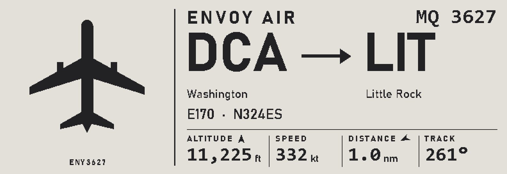

<div align="center">
  <h1>paper-planes</h1>

  <p>A plane passes overhead, you glance at the shelf:<br><strong>airline, route, aircraft type and live altitude and speed</strong><br>on a 5.79" e-paper panel, from free public ADS-B data.</p>

  <p>
    
    
    
    
    
  </p>
</div>

<p align="center">
  
</p>

Firmware for the [Elecrow CrowPanel ESP32 E-Paper 5.79-inch HMI Display](https://elecrow.com/wiki/CrowPanel_ESP32_E-paper_5.79-inch_HMI_Display.html)
that shows the aircraft nearest to home. It runs stand-alone: the board looks
the flights up itself and serves the same screen and its settings at
http://flights.local. Its rules are a port of
[flight-tracker](https://github.com/billydavis/flight-tracker)'s
`/api/epaper/nearest`, so the two agree on what's overhead.

> **Full disclosure:** built with an AI doing most of the typing. It has unit
> and parity tests and runs on my board every day, but it's a hobby project:
> expect rough edges.

## Run it

Requires [PlatformIO](https://platformio.org/) and Python 3 with Pillow,
`certifi` and `cryptography` (`pip install pillow certifi cryptography`) for
the build's generators.

1. Optional: copy `src/secrets.example.h` to `src/secrets.h` to bake in
   starting values (Wi-Fi, home location, ...). Settings saved from the web
   page win.
2. Build and flash over USB (`upload_port` in `platformio.ini` is `COM5`):

   ```bash
   pio run -t upload
   ```

   This flashes the firmware **and** the airport data partition. Set
   `SKIP_AIRPORTS=1` to flash just the firmware, or run
   `pio run -t uploadairports` for just the data.
3. With no Wi-Fi saved, or if it can't join the saved network within 20 s, the
   board opens a **setup hotspot**, `flights-setup`. Its password is made up
   by each board and shown on the panel (and on the serial log). Join it and
   the settings page pops up (or open http://192.168.4.1). Set Wi-Fi and the
   home location, and it starts showing flights.

Later updates can go over Wi-Fi at http://flights.local/update:
`.pio/build/esp32-s3-devkitc-1/firmware.bin` and, only when the airport list
changes, `src/generated/airports.bin`.

## How it works

Every poll (10 s by default) the board asks the free ADS-B feeds for aircraft
within the radius (15 nm by default), picks the closest airborne one, looks up
the airframe and route, and draws it. No PC in the loop.

| Lookup         | Purpose                                  | Source                         |
| -------------- | ---------------------------------------- | ------------------------------ |
| aircraft feed  | live positions near home                 | adsb.lol, then opendata.adsb.fi |
| airframe       | registration / type / operator           | hexdb.io, then adsbdb.com      |
| route          | callsign → scheduled origin / destination | adsbdb.com, then hexdb.io      |
| airports       | names, positions, nearest airport        | OurAirports (on the board)     |

The route rules (`lib/flights/src/route.cpp`) match flight-tracker's
`epaper.py` + `sources.py`: same sources, same route-trust labels
(`confirmed` / `scheduled` / `track` / `mismatch`), same departure memory.
The parity tests check them against flight-tracker's own answers.

The feed connection is kept open between polls, so a routine poll takes
~0.4 s instead of ~3.4 s (a new TLS handshake). A new aircraft costs a few
more seconds for its airframe and route lookups, which are cached (airframes
24 h, routes 30 min).

### The web page

The board serves `http://flights.local` (mDNS; the name is a setting):

| Page              | Purpose                                                        |
| ----------------- | -------------------------------------------------------------- |
| `/`               | the frame on the panel right now, the flight details, device status |
| `/settings`       | Wi-Fi, home location, radius, poll interval, time zone, night hours, settings password, demo mode. Saved to flash |
| `/update`         | upload a new `firmware.bin` or `airports.bin` (only once a settings password is set) |
| `/screen.bmp`     | the panel's frame as an image                                  |
| `/api/nearest`    | the current flight as JSON, same shape as flight-tracker's endpoint (plus `lat`, `lon`) |
| `/api/state`      | the flight plus device status                                  |
| `/api/settings`   | the settings (no secrets)                                      |
| `/api/networks`   | Wi-Fi networks in range, for the settings page                 |

The pages are ordinary files in `web/`; the build gzips them into the firmware.

### Night hours

On by default, 22:00 to 07:00 (settings page). The panel is wiped to white,
put into deep sleep and its power cut; no lookups run. The web page keeps
working. At the end of the window it looks up the nearest plane and redraws
from a clean full refresh. Needs the clock (NTP), so it never sleeps before
the time is known.

### Refresh

When the aircraft changes (~3.3 s) the panel is wiped to white and the new
screen drawn from that clean state, which is Elecrow's own sequence; a plain
full refresh left the previous screen ghosted. When only the numbers change
it does a partial refresh (~0.9 s), with a forced clean redraw every 20
partials or 30 minutes.

### Logos

`tools/logogen.py` downloads each airline's logo once from
[Jxck-S/airline-logos](https://github.com/Jxck-S/airline-logos) (by ICAO code,
for every airline in flight-tracker's `airlines.js` plus a few bizjet
operators) into `logos/raw/`, dithers it to 1-bit and writes
`src/generated/logos_gen.h`. `logos/preview.png` shows them all as the panel
will. Drop `logos/custom/<ICAO>.png` in to replace one, then rerun the script.
`logos/` is git-ignored: the logos are the airlines' trademarks, so a fresh
clone has none until you run it. Aircraft with no logo get a silhouette by
aircraft class.

### Security

Set a settings password (user `admin`) on the settings page; without one
anyone on your network can change settings, and updates stay off. The server
only answers to its own name/IP (blocks DNS rebinding), refuses form posts
from other sites (CSRF), and sends no CORS header, so other web pages can't
read it. It's plain HTTP on the LAN: someone already on your network can
sniff the password. Settings, including the Wi-Fi password, are stored
unencrypted in the board's flash, and `secrets.h` values are compiled into
`firmware.bin`, so don't share a build made with a real `secrets.h`.

### Build steps

The build (`tools/pio_generate.py`) regenerates `src/generated/` when its
inputs change:
- fonts (`tools/fontgen.py`; Pillow and the Windows fonts)
- airline logos (`tools/logogen.py`, above)
- airport data, airline names and root certificates (`tools/datagen.py`).
  These come from flight-tracker (`../flight-tracker`, or
  `FLIGHT_TRACKER_DIR`): `data/airports.csv`, `airlines.js`, the IATA map in
  `epaper.py`. Without a flight-tracker checkout it uses
  `tools/airlines_snapshot.json` and downloads `airports.csv` from
  OurAirports, so a fresh clone still builds.
- the web pages (`tools/webgen.py`)
- `version_gen.h` (`git describe`; shown on the web page and in the boot log)

Flash layout (`partitions.csv`): two 2.6 MB firmware slots, a 2.5 MB
`airports` partition (the ~1.5 MB airport image, checked by CRC at boot), NVS
for settings and a core-dump slot. The chip's 8 MB PSRAM is enabled
(`dio_opi`), which leaves ~224 KB of internal heap free.

### Debugging

Serial commands (115200 baud): `d` dump the screen, `f` force a full refresh,
`n` next demo flight (in live mode it shows until the next poll, handy for
checking a logo). `python tools/grab_screen.py NAME [--next] [--compare mockup_1bit.png]`
saves the panel's current frame to `docs/screens/` (and diffs it against a
mockup). Log detail: build flag `-DLOG_LEVEL=3` for debug output (default 2).

## Tests

```bash
pio test -e native
```

Runs on the PC, no board needed. Needs a host `g++`; on Windows, WinLibs:

```bash
winget install BrechtSanders.WinLibs.POSIX.UCRT
```

- `test_parity`: every fixture in `test/fixtures/` holds the upstream replies
  flight-tracker's `nearest()` got and the answer it gave; the C++ rules must
  reach the same answer. `python tools/make_fixtures.py` regenerates the
  synthetic ones (one per route rule); `--live` also records real traffic
  around a few big airports. Rerun it when flight-tracker's rules change.
- `test_flights`: geometry, accent folding, the airport image (lookups, CRC,
  bounds), the flight JSON, departure memory, URL-safe hex/callsigns
- `test_settings`: the settings table and form rules, night window
- `test_panel`: the fast canvas-to-panel conversion against the vendor
  driver's per-pixel formula

## Hardware

Checked against the physical unit:

- MCU: ESP32-S3-WROOM-1, 8 MB flash (quad), 8 MB embedded PSRAM, CH340 USB-serial
- Panel: 272x792 black and white, two SSD1683 driver chips (396x272 each), SPI
- Built-in controls: MENU button, EXIT button, 3-way rotary switch (up/down/confirm)
- TF/SD card slot on its own SPI bus (MOSI 40, MISO 13, CLK 39, CS 10)
- E-paper control pins (bit-banged, from Elecrow's reference code):
  `SCK=12, MOSI=11, RES=47, DC=46, CS=45, BUSY=48`.
  GPIO7 must be driven HIGH to power the panel before it responds.

Raw refresh timings, measured by `examples/refresh_timing.cpp` up to the end
of the BUSY-pin wait (so real panel completion, not just SPI transfer):

| Mode            | Function            | Measured |
| --------------- | ------------------- | -------- |
| Full refresh    | `EPD_Update()`      | ~2120 ms |
| Fast refresh    | `EPD_FastUpdate()`  | ~1995 ms |
| Partial refresh | `EPD_PartUpdate()`  | ~642 ms  |

The firmware's own times (above) are longer because they include drawing the
frame and, for a new aircraft, the wipe to white.

A full 8 MB backup of the board's original (as-purchased) firmware is saved
locally at
`%USERPROFILE%\Documents\esp32_backups\crowpanel_579_full_8MB_backup_2026-10-26.bin`.
Restore with:

```bash
python -m esptool --port COM5 write-flash 0x0 crowpanel_579_full_8MB_backup_2026-10-26.bin
```

## Files

```
src/
  main.cpp              setup()/loop(): hands over to app/
  app/                  what the board is doing
    app.cpp             the Mode (setup, night, live, stale, ...), polling, drawing
    network.cpp         Wi-Fi, setup hotspot, NTP
    settings_store.cpp  settings in flash (NVS), setup-hotspot password
    demo.cpp            built-in sample flights
    constants.h         timings and cache lifetimes
    log.h               LOGI/LOGW/... with a level
  flights/
    sources.cpp         live lookups: feed, hexdb, adsbdb (HTTP + caches)
    airport_data.cpp    maps the airport partition, over-the-air data updates
  net/https.cpp         HTTPS GET + JSON, certificates checked, keep-alive
  ui/                   canvas, screen layouts, fonts/logos, the e-paper panel
  web/
    server.cpp          routes and handlers
    guard.cpp           Host / Origin / password checks
    bmp.cpp             the panel frame as a BMP
  secrets.example.h     template for optional first-boot settings (secrets.h)
  generated/            build output (git-ignored)
lib/
  flights/              route rules, airport image, flight record (no I/O)
  settings/             the settings table: one row per setting
  panel/                canvas <-> panel memory layout
  EPD_Driver/           Elecrow's low-level EPD driver, vendored
web/                    the board's web pages (HTML/CSS)
test/                   native tests + parity fixtures
tools/                  generators, fixture maker, mockups, screen grabber
docs/                   design plan, mockups, screen grabs
examples/               the refresh-timing test
vendor_reference/       Elecrow's original sample files
```

To add a setting: a member in `lib/settings/src/settings.h`, a row in
`SETTINGS_FIELDS` (`settings.cpp`), an input in `web/settings.html`. Storage,
the form and the JSON follow from the table.

`lib/EPD_Driver/` is from
[Elecrow-RD/ESP32_S3-Ink-Screen](https://github.com/Elecrow-RD/ESP32_S3-Ink-Screen).
The design plan and mockups are in `docs/flight-display-plan.md` and
`docs/mockups/`.

## License

MIT (see `LICENSE`). Do whatever you want with it. That covers this project's
own code; Elecrow's driver in `lib/EPD_Driver/` and `vendor_reference/` are
theirs, and airline logos stay their owners' trademarks.
